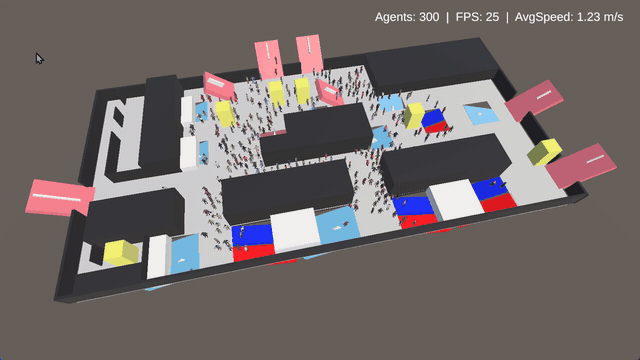
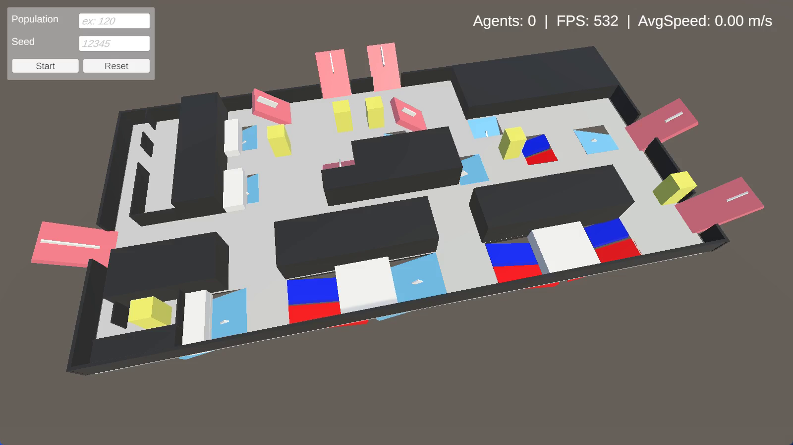
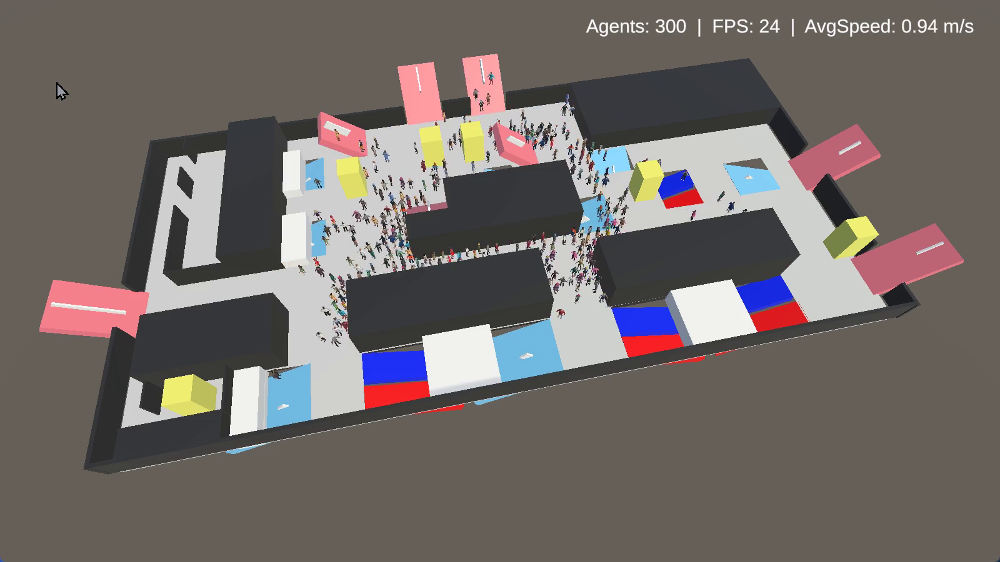
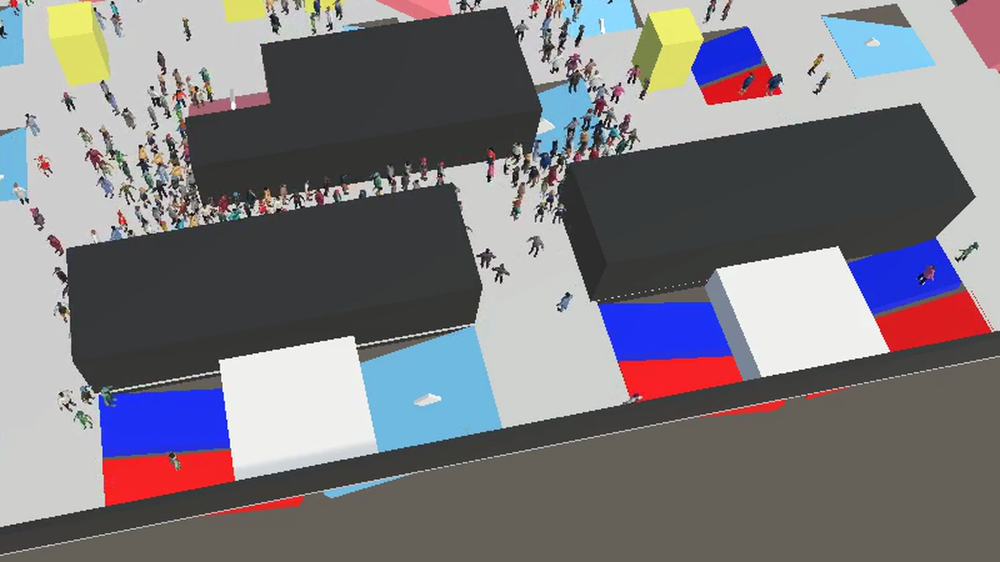

# CrowdSim

> **KCGS 2025 포스터 발표** · [프로젝트 페이지](https://wri0raan.github.io/JURAN/research/crowd-sim.html)

실제 지하철역(신도림역 B1) 공간을 모델링한 에이전트 기반 실시간 군중 시뮬레이션입니다.
연구에서는 개별 에이전트의 감정 상태가 주변으로 전파되는 **정서 상태 전파(ASP, Affective State Propagation)** 모델과 AI 기반 이벤트 계획 구조를 제안했으며, 본 저장소는 그 시뮬레이션 기반 구현을 담고 있습니다.



## Overview

| 항목 | 내용 |
|---|---|
| 분야 | Crowd Simulation, Agent-based Modeling |
| 엔진 | Unity 6 (6000.0.58f1), C# |
| 이동 | NavMesh 경로 탐색 + 회피 |
| 공간 | 신도림역 B1 (1F·B2 연결 계단, 에스컬레이터 포함) |
| 논문 | 「정서 기반 행동 반응 확산을 활용한 AI 군중 시뮬레이션 프레임워크」 ([PDF](docs/paper.pdf), [발표자료](docs/presentation.pptx), [B1 도면](docs/sindorim_b1_map.pptx)) |

## Key Features

- **파라미터 기반 생성**: 인구수·랜덤 시드 입력으로 재현 가능한 시뮬레이션 구성
- **스폰 분포**: 1F→B1, B2→B1 유입 동선과 B1 내부 생성 비율 4 : 3 : 3
- **목적지 기반 이동**: 계단·에스컬레이터·출구로 이어지는 경로 이동, 출구 트리거 도달 시 제거
- **트리거 존 자동 분류**: 오브젝트 명명 규칙으로 스폰·출구 구역 타입 자동 판별
- **이벤트 스케줄러**: JSON 이벤트 계획을 시간축에 따라 실행
  - `rush_start` — 지정 지점 반경 내 에이전트 일부의 속도 증가 및 목적지 변경
  - `stumble` — 일부 에이전트의 일시 정지
  - `staff_gesture` — 안내 지시에 따른 경로 변경
- **실시간 지표 HUD**: 에이전트 수, FPS, 평균 이동 속도
- **에디터 자동화**: 캐릭터 모델 Humanoid 일괄 설정, 프리팹·애니메이터 자동 생성

## Research Summary

- 에이전트 감정을 Valence–Arousal 2차원으로 표현하고 이벤트 강도·거리·역할·민감도에 따라 갱신
- 감정 상태의 표정·제스처 표현 및 주변 에이전트로의 전파(Emotional Contagion)
- 규칙 기반 또는 LLM 기반 AI가 시간·위치·강도를 포함한 이벤트 계획 생성
- 200 에이전트 규모에서 60fps 이상 유지

## Scripts

| 파일 | 역할 |
|---|---|
| `Crowd/CrowdSystem.cs` | 트리거 존 기반 스폰·출구 관리, 인구 생성 |
| `Crowd/AgentController.cs` | NavMesh 에이전트 설정, 경로 이동, 제거 |
| `Crowd/TriggerZone.cs` | 스폰·출구 구역 정의 및 진입 처리 |
| `Crowd/Scripts/CrowdSpawner.cs`, `CrowdStartUI.cs` | 인구수·시드 입력, 스폰 실행 |
| `Crowd/Scripts/AgentModifiers.cs` | 속도 증가, 일시 정지, 목적지 변경 |
| `Core/EventScheduler.cs`, `EventPlan.cs` | 이벤트 계획 로드·실행 |
| `Core/SpawnManager.cs` | 역할(하차·승차·역무원) 비율 기반 스폰 |
| `HUD/MetricsHUD.cs` | 실시간 지표 표시 |
| `Crowd/Editor/*` | 모델 임포트, 프리팹·애니메이터 생성 자동화 |

## Repository Structure

```
Scripts/   직접 작성한 C# 스크립트
media/     스크린샷, 미리보기 GIF
docs/      논문, 발표 자료, 신도림역 B1 도면
```

> Unity 프로젝트 전체와 캐릭터 에셋은 제외했습니다.

## Screenshots

| 초기 상태 | 300 에이전트 | 확대 |
|---|---|---|
|  |  |  |
